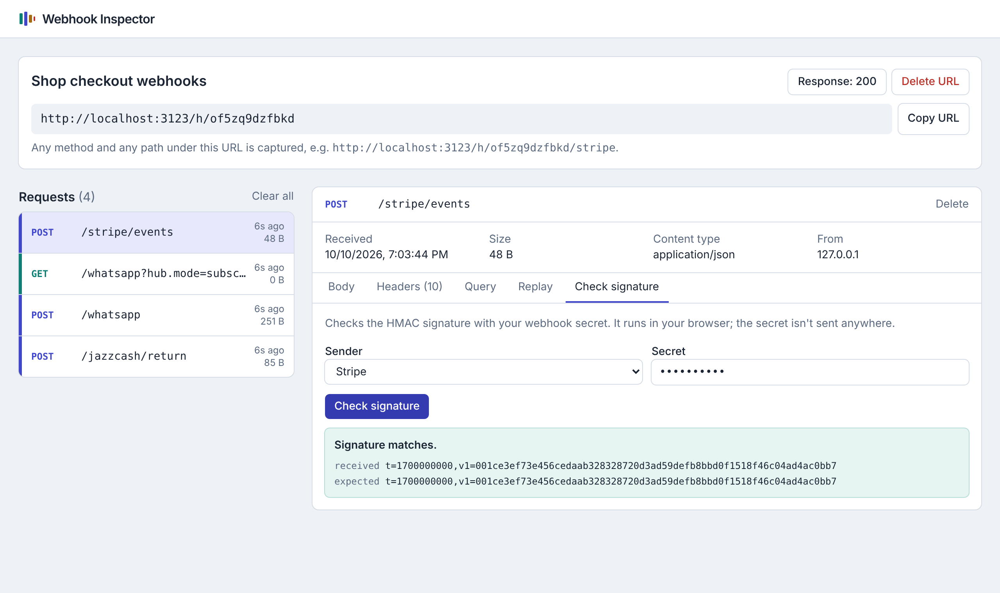

# webhook-inspector

A self-hosted place to **catch, read and replay webhooks**. Create a URL, point Stripe, GitHub,
WhatsApp, JazzCash or any other sender at it, and watch each request arrive with its headers,
query and body. Then check the signature with your secret, or send the same request again to
your local server.

Like the hosted request bin sites, but on your own server, so payment callbacks and customer
data don't pass through someone else's logs.

[](https://github.com/softechies/webhook-inspector/actions/workflows/ci.yml)




## What it does

- **Captures everything.** Any method and any path under `/h/{id}`, e.g. `/h/{id}/stripe/events`.
  Binary bodies are kept byte for byte and shown as a hex dump.
- **Reads bodies for you.** JSON is formatted, form posts are split into fields.
- **Checks signatures** for GitHub, Meta (WhatsApp, Facebook, Instagram), Stripe, Shopify, Slack, or
  any HMAC scheme you describe. The check runs in your browser; the secret is never sent to the server.
- **Replays requests** to another URL with the same method, headers and body, so signatures
  still pass. Or copy it as a `curl` command.
- **Answers how you want.** Set the status, headers, body and a delay per URL, to see how a
  sender handles a 500 or a slow endpoint.
- **Updates live.** New requests appear within two seconds.
- **No database server.** Data goes into one SQLite file using Node's built-in driver, so there
  is nothing to install or compile.

## Run it

### Docker

```bash
git clone https://github.com/softechies/webhook-inspector.git
cd webhook-inspector
INSPECTOR_PASSWORD=choose-one docker compose up -d
```

Open http://localhost:3000. Data is kept in the `inspector-data` volume.

### Node

Needs Node 22.13 or newer.

```bash
npm install
npm run build
npm start
```

For development, `npm run dev`.

## Getting webhooks from the internet

Senders need a public URL. Either deploy the inspector on a server with a domain (put it behind
Nginx or Caddy for HTTPS), or run it locally and expose it with a tunnel such as
`cloudflared tunnel --url http://localhost:3000`.

Set `PUBLIC_URL` if the URLs shown in the app don't match the address senders use.

**Set `INSPECTOR_PASSWORD` before putting it online.** It locks the pages and the API with a
browser login (any username). Webhook URLs under `/h/` stay open, since senders can't log in;
their ids are random and hard to guess.

## Settings

| Variable | Default | |
| --- | --- | --- |
| `DATABASE_PATH` | `./data/inspector.db` | SQLite file. `/data/inspector.db` in Docker. |
| `MAX_REQUESTS_PER_BIN` | `500` | Older requests are dropped past this. |
| `MAX_BODY_BYTES` | `1048576` | Bigger bodies are cut; the real size is still shown. |
| `INSPECTOR_PASSWORD` | empty | Turns on the login. |
| `PUBLIC_URL` | empty | e.g. `https://hooks.example.com` |

See [`.env.example`](.env.example).

## API

Everything in the UI is also available over JSON, handy for scripts and tests.

| Method | Path | |
| --- | --- | --- |
| `POST` | `/api/bins` | Create a URL. Body: `{ "name": "Stripe test" }` |
| `GET` | `/api/bins` | List URLs |
| `GET` `PATCH` `DELETE` | `/api/bins/{id}` | Read, rename or change the response, delete |
| `GET` | `/api/bins/{id}/requests?after=ISO_TIME` | Captured requests, newest first |
| `DELETE` | `/api/bins/{id}/requests` | Clear all |
| `GET` `DELETE` | `/api/requests/{id}` | One request, body as base64 |
| `POST` | `/api/requests/{id}/replay` | Body: `{ "url": "http://localhost:3000/api/webhooks" }` |

Example: wait for a webhook in an end to end test.

```bash
ID=$(curl -s -X POST localhost:3000/api/bins -H 'Content-Type: application/json' -d '{"name":"e2e"}' | jq -r .id)
# ...configure the sender with http://your-host/h/$ID, trigger it...
curl -s localhost:3000/api/bins/$ID/requests | jq '.[0]'
```

## Development

```bash
npm install
npm test          # store, capture, formatting, replay and signature checks
npm run typecheck
npm run build
```

Signature test vectors were computed separately with Python's `hmac` module.

## Related

- [pk-payments-sdk](https://github.com/softechies/pk-payments-sdk): JazzCash and Easypaisa for Node.js
- [whatsapp-cloud-sdk](https://github.com/softechies/whatsapp-cloud-sdk): WhatsApp Cloud API client with webhook parsing

## License

MIT

---

Built and maintained by [Softechies Solutions](https://softechies.net). More open source work at
[github.com/softechies](https://github.com/softechies).
